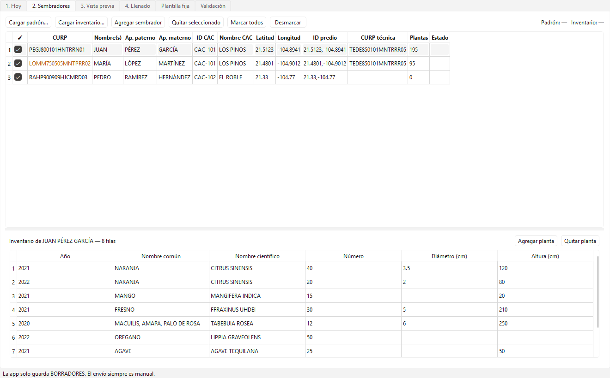

# AutoForm PSV

App de escritorio (Windows) que **prellena** el formulario Enketo
"Información de Unidades Productivas y Especies PSV"
(<https://ee.sembrandodatos.com/x/7kMmQETh>) y lo deja guardado como
**borrador**. **Nunca envía**: el envío siempre lo hace una persona.

La idea: capturar la plantilla **una vez**, los datos del día **una vez al día**,
y por cada sembrador solo los ~6 datos que cambian (CURP, nombre, apellidos,
CAC, ID del predio/coordenadas) más su inventario.

## Instalación (una sola vez)

Requisitos: Windows 10/11 y [Python 3.11 o superior](https://www.python.org/downloads/)
(marca "Add Python to PATH" al instalar).

```powershell
git clone https://github.com/BetoCW/FormsITComSembrandoVida.git
cd FormsITComSembrandoVida
pip install -r requirements.txt
python -m playwright install chromium
```

Abrir la app:

```powershell
python -m autoform
```

Opcional: `build_exe.bat` genera `dist\AutoFormPSV\AutoFormPSV.exe` para abrirla con doble clic
(requiere `pip install pyinstaller`; el navegador Chromium se sigue tomando de la instalación de Playwright).

## Primer uso (una vez)

1. Abre la pestaña **Plantilla fija** y revisa las respuestas iguales para todos los sembradores.
   Las celdas en **amarillo** están PENDIENTES (por ejemplo, la sección *Cultivo anual 1*):
   llénalas una vez y presiona *Guardar plantilla*. La pregunta con `*` es obligatoria.
2. La primera vez que abras el navegador de la app, si el sitio pide iniciar sesión, hazlo a mano;
   la sesión queda guardada en el perfil de la app (`data/browser_profile`). La app nunca guarda contraseñas.

## Uso diario



1. **Hoy**: fecha, hora de inicio/término (o "horas automáticas"), CURP del técnico
   y calidad de la entrevista → *Guardar datos del día*.
2. **Sembradores**: *Cargar padrón…* y *Cargar inventario…*, o *Agregar sembrador*
   y escribir los datos a mano en la tabla (el inventario se captura abajo).
   Todo se guarda solo en `data/sesion.json`.
3. **Vista previa**: revisa lo que se llenará; la columna *Valor* es editable
   (las ediciones salen en azul y solo aplican a ese sembrador). Amarillo = PENDIENTE.
4. **Llenado**: *Prellenar sembradores marcados*. Con "pausa antes de guardar"
   la app se detiene para que revises el navegador y confirmes el borrador
   `CURP - Nombre`. Al final escribe un reporte Excel en `output/`.
5. **Revisar / ENVIAR a mano**: abre el mismo navegador de la app (los borradores
   viven en su perfil, `data/browser_profile`). Los borradores están en el icono de la
   cola, arriba a la izquierda. Ahí se envían manualmente.

La pestaña **Validación** muestra los problemas antes de llenar (especies sin
coincidencia, sin categoría, duplicados, sembradores sin inventario) y permite
**aprobar correcciones de especies**, que se recuerdan en `config/alias_especies.yaml`.

### Formato de los Excel

- **Padrón** (una fila por sembrador): `CURP, POLIGONO, Apellido_p, Apellido_m, Nombre, CAC_ID, NOMBRE_CAC,
  CENTROIDE_LATITUD, CENTROIDE_LONGITUD, ID_PREDIO ("lat,lon"), TECNICA, CURP de la técnica`.
- **Inventario** (varias filas por sembrador; el encabezado puede estar en la fila 2):
  `ID DEL SEMBRADOR, NOMBRE SEMBRADOR, CAC, POLÍGONO, HA, AÑO DE ESTABLECIMIENTO, NOMBRE COMÚN,
  NOMBRE CIENTÍFICO, NÚMERO, CM DIÁMETRO, M ALTURA`. Se une al padrón por nombre completo
  (o por `ID DEL SEMBRADOR` si ambos lo traen).

Hay ejemplos ficticios en `tests/datos/`. Si tus columnas se llaman distinto, agrégalas en `config/mapeo_padron.yaml`.

**Plantilla fija** edita las respuestas iguales para todos (tabla con listas de
opciones, o YAML completo para matrices, especies tolerantes, cultivos eje y
cultivo anual). Cada guardado deja un respaldo `config/plantilla.*.bak`.

## Seguridad: no se envía nada

- La red del navegador automatizado **aborta todo POST/PUT/PATCH/DELETE**
  salvo la descarga del formulario (`/transform/`) y el login (`autoform/guard.py`).
- El botón *Enviar* se oculta y se deshabilita por script.
- `guard.check_selector`/`safe_click` lanzan `SubmitForbidden` si algo apunta a
  *Enviar*.
- El reporte incluye la lista de peticiones bloqueadas (en las pruebas: ninguna).

## Configuración (`config/`)

| Archivo | Para qué |
|---|---|
| `plantilla.yaml` | Respuestas fijas. Valor = texto visible de la opción; `null` = PENDIENTE |
| `dia.yaml` | Datos del día (lo edita la pestaña *Hoy*) |
| `mapeo_padron.yaml` | Columnas del padrón → campos del formulario |
| `inventario.yaml` | Duplicados (`deduplicar`/`sumar`/`mantener`), umbral fuzzy, SAF/MIAF, máx. cultivos eje |
| `categorias_especies.yaml` | Especie → Forestales / Agroindustrial / Frutales / Especias |
| `alias_especies.yaml` | Correcciones aprobadas de nombres de especies |

## Línea de comandos

```powershell
python -m autoform descubrir --descargar     # baja el formulario y regenera output/form_schema.json
python -m autoform validar --padron P.xlsx --inventario I.xlsx
python -m autoform llenar  --padron P.xlsx --inventario I.xlsx --pausa [--curp CURP1 CURP2]
```

## Módulos

`form_schema.py` (descubrimiento), `excel_padron.py`, `excel_inventario.py`,
`especies.py` (catálogo, fuzzy, categorías), `template.py` (plan por sembrador),
`repeats.py` (planta establecida y cultivos eje), `matrix.py`, `filler.py`
(Playwright), `guard.py`, `report.py`, `batch.py`, `gui.py`.

## Pruebas

```powershell
python tests/make_sample_excels.py   # Excel ficticios con duplicados, ".20", FFRAXINUS, etc.
python tests/test_offline.py         # sin navegador
python tests/live_widgets_test.py    # abre el formulario (perfil de prueba), NO guarda
python tests/live_e2e_test.py        # llena un sembrador ficticio y guarda borrador LOCAL en el perfil de prueba
```

Ver `docs/CAMPOS.md` para la lista de obligatorios y qué es fijo, del día o por sembrador.
